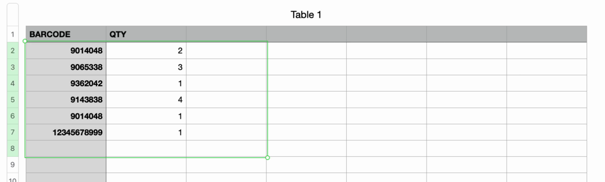
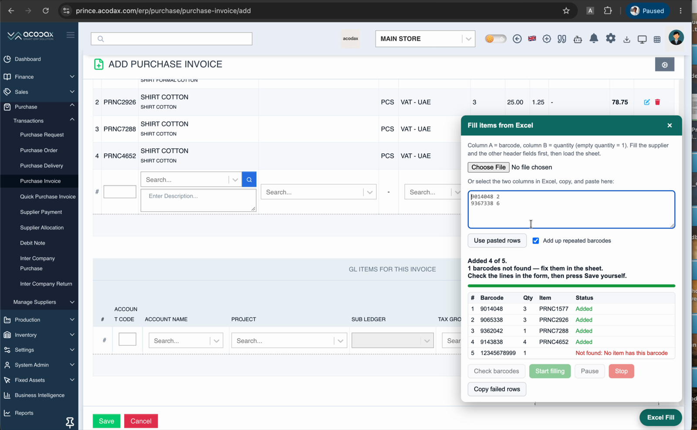

# Acodax Excel Fill

A Chrome extension that fills Acodax ERP item lines from an Excel sheet. It replaces the manual routine of scanning a barcode, picking the item, typing the quantity and pressing **+** for every row.

Works on **Add Purchase Invoice** and **Add Stock Transfer**, and on any other Acodax form built on the same item entry row.

Scan barcodes into a sheet, with the quantity next to each one:

Copy the rows into the Excel Fill panel (or load the file) and press **Start filling**. Every line is added to the form, and barcodes that don't exist are listed so you can fix them:

## Sheet layout

| A: Barcode | B: Quantity |
|---|---|
| 1234567890123 | 2 |
| 9876543210987 | 6 |

- A header row is optional and is skipped automatically.
- An empty quantity counts as **1**, so you can just scan barcodes one per row.
- Repeated barcodes are added up (you can turn this off in the panel).
- `.xlsx`, `.xls` and `.csv` files work. You can also copy the two columns in Excel and paste them into the panel.

## Using it

1. Open **Add Purchase Invoice** (or **Add Stock Transfer**) in Acodax.
2. Fill the supplier, date and the other header fields.
3. Click **Excel Fill** at the bottom right, then load the sheet or paste the rows.
4. Optional: press **Check barcodes** to see which barcodes are not found before filling.
5. Press **Start filling**. Every line shows its status. You can pause or stop at any time.
6. Check the lines in the form, then press **Save** yourself. The extension never saves.

Rows that fail can be copied back to Excel with **Copy failed rows**.

## How it picks the item

The item dropdown only shows item names, and many items share a name. So for each barcode the extension:

1. Looks the barcode up with the ERP's own item search, using the logged-in user's session.
2. Opens the candidates' item details and accepts only an exact barcode match (or an exact item code). Leading zeros dropped by Excel are tolerated.
3. Searches the dropdown by that item's unique code, picks it, and checks the item code the row shows.
4. Types the quantity, presses **+**, and waits for the line to be added before the next one.

It stops and tells you if the form rejects a line. It waits for you if a warning popup appears. If the form lowers a quantity (for example, not enough stock on a stock transfer), that line is skipped and marked failed.

The user needs permission to view items (`show-item`) for the barcode check.

## Install

**From this repository (Developer mode):**

1. Download or clone this repository and keep the folder somewhere permanent.
2. Open `chrome://extensions` and turn on **Developer mode**.
3. Click **Load unpacked** and choose the folder.
4. Reload any open Acodax tab.

The extension runs on `*.acodax.com` and `*.axisproerp.com`. For a tenant on its own domain, add it to `content_scripts.matches` in `manifest.json`.

## Credits

Developed by [muhammedv](https://github.com/muhammed770/).

Reads Excel files with [SheetJS](https://sheetjs.com/) Community Edition (Apache 2.0, see `vendor/xlsx.LICENSE`).
